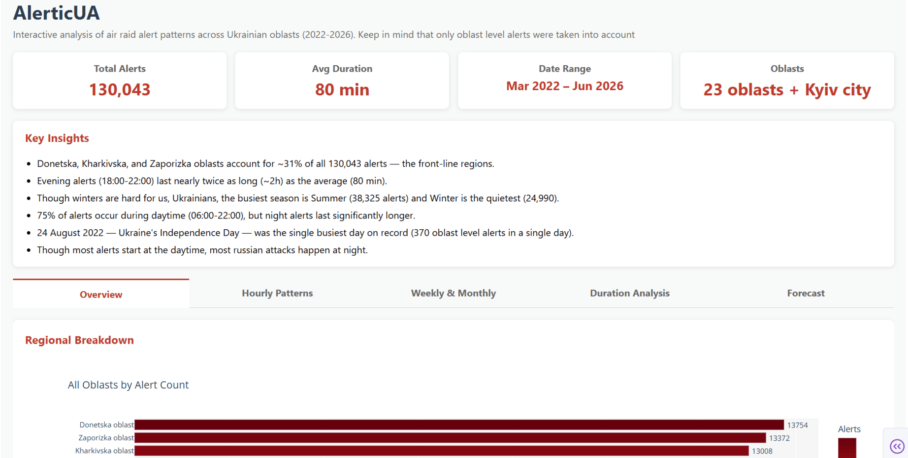

# AlerticUA 🚨

[](https://github.com/Heir-of-God/AlerticUA)
[](https://github.com/Heir-of-God/AlerticUA)
[](https://github.com/Heir-of-God/AlerticUA/blob/main/requirements.txt)
[](https://github.com/Heir-of-God/AlerticUA/stargazers)
[](https://github.com/Heir-of-God/AlerticUA/blob/main/LICENSE)

Welcome! AlerticUA is my pet project where I look at how air raid alerts in Ukraine are distributed in time and space: where they happen most, at which hours, how long they last, and whether the daily number can be forecast. It has a small Dash dashboard, a command-line summary and a Prophet forecast. I built it to practice data analysis with pandas and to learn how to structure a Python project, so please treat it as a learning project and not as a warning system. 🙏

## 📷 Preview



*The recording was made before the data fixes described below, so the numbers in it are higher than the current ones.*

## 🤔 What question does it answer?

When and where do air raid alerts happen, how long do they last, and can the number of alerts per day (and their average duration) be forecast from past data?

## 🔎 Findings

All numbers are real output of `python main.py` and `python -m src.forecasting` on the bundled dataset: 65,123 oblast-level alerts in 24 regions (23 oblasts and Kyiv city), 2022-03-15 to 2026-06-18. Hours, weekdays and day/night are in Kyiv time.

- **Where:** Donetska (6,877), Zaporizka (6,686) and Kharkivska (6,504) oblasts have the most alerts, 31% of all.
- **How long:** mean 4,771 s (about 80 min), median 2,418 s (about 40 min). Sumska oblast has the longest average alert (about 117 min).
- **When (hour):** alerts most often start at 12:00-13:00 (3,524), 13:00-14:00 (3,463), 21:00-22:00 (3,406) and 9:00-10:00 (3,405). The quietest start hour is 6:00-7:00 (1,425).
- **Evenings last longer:** alerts starting 18:00-22:00 average 108 min versus 80 min overall.
- **Day vs night:** 70% of alerts start between 06:00 and 22:00, but night alerts last longer (95 min on average versus 73 min by day).
- **Weekdays:** Thursday is the busiest (9,838), Sunday the quietest (8,186).
- **Seasons:** Summer 19,197, Spring 18,506, Autumn 14,905, Winter 12,515 alerts.
- **Busiest day:** 2022-08-24 with 189 oblast-level alerts, then 2023-08-25 with 159.

### 🔧 What I fixed in the data

While checking the numbers I found that the raw file contains two overlapping snapshots of the dataset glued together: 271,160 rows, of which only 157,315 are unique. Every earlier count was therefore roughly doubled, so the pipeline now drops exact duplicate rows first. The timestamps in the dataset are UTC, so hour, weekday and day/night used to be shifted by 2-3 hours; they are now converted to Europe/Kyiv.

### 📉 Forecast quality

The forecast is a Prophet model, evaluated on the 14 days after a cutoff date it has not seen:

| Target | Holdout MAE (cutoff 2025-07-17) | Mean MAE over 6 windows | Naive baseline MAE |
| --- | --- | --- | --- |
| Alerts per day | 12.8 (MAPE 21%) | 12.2 (MAPE 27%) | 12.3 |
| Average duration per day | 2,659 s | 2,116 s | 2,102 s |

The "naive baseline" is simply the mean of the last 14 training days. Prophet is about as good as that baseline here, not better, so I would call it a demo rather than a usable predictor. The 6 windows have cutoffs 30 days apart, ending at 2025-07-17.

## ✨ Features

- **Data pipeline**: load, deduplicate, clean and cache oblast-level data (the cache is rebuilt automatically when the raw file or cleaning logic changes)
- **Analysis**: patterns by region, hour, weekday, month, season and day/night
- **Dashboard**: five tabs - Overview, Hourly Patterns, Weekly & Monthly, Duration Analysis, Forecast
- **Forecast**: Prophet predictions of daily alert count and average duration with a holdout error shown next to them
- **Tests**: a few pytest tests for the cleaning steps, time zones and forecast metrics

## 📂 Project Structure

```
AlerticUA/
├── data/
│   ├── raw/              # Original dataset snapshot
│   └── processed/        # Cleaned cache (generated, gitignored)
├── dashboard/
│   ├── theme.py          # Colours and small layout helpers
│   ├── figures.py        # Plotly figure builders
│   ├── layout.py         # Page layout and tabs
│   └── callbacks.py      # Forecast tab callback
├── docs/assets/          # Dashboard demo GIF
├── src/
│   ├── config.py         # Paths, constants, time zone
│   ├── data_loader.py    # Load, clean and cache the data
│   ├── analysis.py       # Statistical analysis
│   └── forecasting.py    # Prophet model and holdout metrics
├── tests/                # pytest tests
├── app.py                # Dash dashboard entry point
├── main.py               # Command-line summary
├── requirements.txt
└── requirements-dev.txt  # + pytest
```

## 📥 Installation

You need Python 3.11 or newer (the pinned pandas 3.0 and numpy 2.4 require it). I tested everything on Python 3.14 on Windows.

1. **First of all, give a star to this repo if you find it interesting or useful** ⭐\
   **Thanks ❤️**

2. **Clone the repository** (you need git installed):
   ```bash
   git clone https://github.com/Heir-of-God/AlerticUA.git
   cd AlerticUA
   ```

3. **Create and activate a virtual environment**:
   ```bash
   python -m venv .venv

   # Windows
   .venv\Scripts\activate
   # Linux / macOS
   # source .venv/bin/activate
   ```

4. **Install the dependencies**:
   ```bash
   pip install -r requirements.txt
   ```

## 🎮 Usage

### Command-line summary

```bash
python main.py
```

Prints the dataset summary and the main statistics. The first run builds the cleaned cache in `data/processed/`.

### Dashboard

```bash
python app.py
```

Open http://127.0.0.1:8050 in your browser. It listens on localhost only and debug mode is off by default. You can change this with the environment variables `ALERTICUA_DEBUG=1`, `ALERTICUA_HOST` and `ALERTICUA_PORT`.

### Forecast and its error

```bash
python -m src.forecasting
```

### Tests

```bash
pip install -r requirements-dev.txt
python -m pytest
```

## ⚠️ Limitations

- **Oblast-level data fades out after mid-2025.** The source switched to mostly raion (district) level alerts: oblast-level rows per month fall from 1,766 in July 2025 to 705 in September and 24 in December 2025. So the last months are under-represented, the daily trend drops sharply, and forecast cutoffs in the dashboard are limited to dates whose 14-day window ends by 2025-07-31. I tried merging raion and hromada alerts into "any alert in the oblast" intervals: monthly counts become continuous, but chained long-lived local alerts create absurdly long durations (up to hundreds of days), so I did not use it.
- Crimea is not in the data and Luhanska oblast (permanent siren, one row) is excluded.
- Alerts longer than 14 days would be dropped as outliers (none are left in this snapshot). Alerts are counted per oblast, so one attack can create many alerts.
- Seasons and months compare periods covered by a different number of years (the data starts in March 2022).
- The forecast is a statistical extrapolation with no knowledge of the real situation, and it is not better than a naive average.

## 📊 Data source

[ukrainian-air-raid-sirens-dataset](https://github.com/Vadimkin/ukrainian-air-raid-sirens-dataset) by Vadimkin, MIT License (official alert records, UTC). A snapshot is bundled in `data/raw/raw_data_en.csv`. Cleaning: exact duplicate rows are dropped, only `oblast`-level rows are kept, Luhanska oblast is excluded and alerts longer than 14 days are removed (none in this snapshot).

## 🔨 Tech Stack

- **Python 3.11+**
- **Dash / Plotly** - interactive dashboard
- **Prophet** - time series forecasting
- **pandas / NumPy** - data processing
- **pytest** - tests

## 👾 Contributing

Contributions welcome! You can open an issue or submit a pull request with improvements, and any bug report or idea will be very appreciated.

## 📃 License

This project is licensed under the MIT License - see the [LICENSE](LICENSE) file for details.

<p align="center">Show ❤️ By Starring This Repo💎</p>
